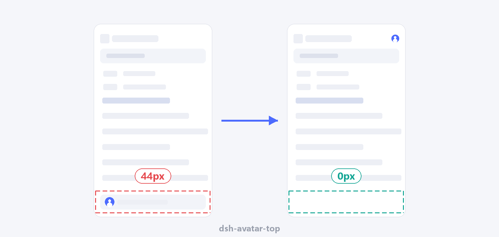

# dsh-avatar-top

[English](README.md) | [中文](README.zh.md)

Moves the left sidebar's account avatar (which is also the Settings launcher) out of the bottom
strip, so the session list gains the space back. Placement, height and spacing are adjustable from
a card on the **Plugins** page; **inline brand row** costs zero vertical space.



> Tested against DeepSeek Harness `0.2.2-rc.1` (desktop, Windows). The macOS desktop is left
> untouched by design; the browser shell works on every platform.

## 0.3.2

Two fixes that only show up on a real desktop:

- The Windows titlebar strip is a `-webkit-app-region: drag` band (DSH paints it with
  `[data-windows-titlebar] .frame:before`). The inline avatar used to sit inside it, so a click
  started a window drag. The container and the button now opt out with `no-drag`.
- The desktop shell snapshots the injection table at Host start, so the boot `<style>` row could
  not be removed when the plugin was switched off — the switch looked dead. Every selector is now
  gated on `:not([data-avatar-top-off])`, an attribute the browser half toggles on `<html>`.

## What it does

DSH pins a footer at the bottom of the left sidebar: the account row (`头像 + 账号名`) sits next to
`sidebar.footer.action`, where plugins such as `dsh-cost-meter` mount their own widgets.

This plugin moves **only the account row**:

- The footer becomes `display: contents`, so its two children join the sidebar's flex column; the
  account row is then reordered while `_footerActions` keeps its default order and stays pinned at
  the bottom. (Moving the whole footer would drag other plugins' widgets along — that was a real
  bug in 0.2.1.)
- Four placements: **top**, **below the brand row**, **below New Session**, or **inline inside the
  brand row** (Windows desktop; `position: absolute` at the free right end, zero vertical cost).
- Three heights: **full 44px**, **compact 32px**, **avatar only 28px** (hides the account name and
  shrinks the avatar to 20px).
- Spacing 0–24px, and an on/off switch that restores the stock layout without uninstalling.
- The desktop update pill (download progress / "ready") shares that flex row. While it is visible the
  **inline** placement temporarily returns to a normal 28px row under the brand row: an absolutely
  positioned row has no width to give the pill, so it would otherwise be drawn underneath the
  avatar. The avatar goes back to the corner as soon as the pill disappears.

Changes apply immediately — the browser half subscribes to the settings document and rewrites the
stylesheet. Switching the plugin off is immediate too: the boot row a desktop session baked in at
Host start is gated on `data-avatar-top-off`, so it goes inert without a restart. Settings persist
in the profile's `cordis.patch.yml`.

## Settings

| Setting | Values | Default |
|---|---|---|
| Enabled | on / off | on |
| Position | top / below brand / below New Session / inline brand row | top |
| Height | full 44 / compact 32 / avatar only 28 | full 44 |
| Spacing below | 0–24 px | 4 |
| Restore defaults | button | — |

## Install

Not on npm yet — install from GitHub:

```sh
dsh plugin add git+https://github.com/kiefeng/dsh-avatar-top
```

Restart DSH once after installing (the client bundle and package metadata are read at host start).
Then open **Plugins → dsh-avatar-top** to configure it.

The npm name `dsh-avatar-top` is reserved; once published, `dsh plugin add dsh-avatar-top` works too.

Self-check: the plugin serves its current stylesheet at `/dsh-avatar-top.css` (public, read-only),
so a wrong layout can be diagnosed without a session:

```
http://127.0.0.1:<dsh-port>/dsh-avatar-top.css
```

## How it works

### Injection channel

The Host contributes one structured `style` row through `webserver/index-inject`:

```js
ctx.on('webserver/index-inject', (table) => {
  table.push({ kind: 'style', text: cssFor(readOptions(config)) })
})
```

Both shells render that row:

| Shell | Where the page comes from | How the row arrives |
|---|---|---|
| Browser / `dsh web` | the SPA dist server answers the index over HTTP | `renderIndex()` renders the rows into the HTML |
| Desktop app | Electron serves `dsh-web-frontend/dist/index.html` itself over its `dsh-app://` scheme | the Host's injection table is handed to the page over IPC after startup; the page-side interpreter appends `style` rows to `<head>` |

`ctx.webServer.tapIndex()` would only cover the HTTP shell; the desktop window never calls it.

The desktop snapshot is taken at Host start, so the browser half also applies the stylesheet live
(`<style id="dsh-avatar-top-live">`, appended after the boot row, so it wins) and the boot row only
prevents a flash on first paint.

### The rule

The sidebar is a flex column; placement is pure `order`, and selectors key off the stable
CSS-module class-name suffixes (`_root`, `_footArea`, `_settingsArea`, `_trigger`, `_label`,
`_avatar`, `_logoRow`, `_newSession`, `_panelList`) rather than the per-build hash prefix.
`_trigger` / `_label` / `_avatar` come from the settings-account module (`AccountMenu`); the rest
from ui-sidebar.

```css
html:not([data-platform='darwin']):not([data-avatar-top-off]) [class*='_root']:not([class*='_collapsed']) > [class*='_footArea'] {
  display: contents;
}
… > [class*='_footArea'] > [class*='_settingsArea'] {
  order: -1;
  margin-bottom: 4px;
}
```

- macOS keeps its traffic-light strip layout (`:not([data-platform='darwin'])`).
- Collapsed rails are left untouched (on Windows the footer is `display:none` there anyway).
- `inlineBrand` lifts the button out of the flow (`top: 8px; right: 12px; z-index: 3`) and forces
  the avatar-only shape. On non-Windows shells it falls back to `top`. The band it lands in is the
  `titleBarOverlay` drag strip, so both the row and the button carry `-webkit-app-region: no-drag`.
  While the update pill exists (`:has([class*='_indicator'])`) the row returns to
  `position: static; order: -3`, i.e. a normal 28px row under the brand row.
- The button selector is
  `[class*='_trigger']:not([class*='_triggerRow']):not([class*='_triggerLabel'])`. A bare
  `[class*='_trigger']` also matches `_triggerRow` — the flex row holding the account button, the
  connection indicator and the update pill — which collapsed the row to 28px and drew the pill
  underneath the avatar (0.3.0 bug). The row itself only gets `flex-wrap: wrap`, so a pill that
  cannot fit wraps instead of being pushed out of the sidebar.

### Settings plumbing

`Config` declares four `volatile()` fields (user settings, not deployment config), so the Host
serves the `avatar-top` namespace (the loader row id). The browser half binds it through
`ctx.configForms.get('avatar-top')`, writes through `config.set()` / `config.unset()` (which reach
`remote.settings.mutate`), and registers its card into the `plugins.bundle.config` keyed slot under
the package name.

## Known limits

- Only the account row moves. Plugins that mount into `sidebar.settings` (instead of
  `sidebar.footer.action`) would ride along; no shipped plugin does that today.
- Layout depends on ui-sidebar's flex column. If upstream switches the footer to absolute
  positioning or moves it out of the column, the rules become no-ops (no errors, no misplacement).
- `inlineBrand` needs the Windows titlebar (`html[data-windows-titlebar]`), where the collapse
  toggle lives in the native titlebar. Elsewhere it falls back to the top placement.
- The macOS desktop is skipped on purpose (traffic lights + drag area). In a browser on macOS the
  rules do apply, because `<html>` carries no `data-platform` there — the two shells differ.
- The diagnostics route is public and read-only; it returns this plugin's CSS text only.

## Development

```powershell
npm install      # @deepseek-ai/schemastery is a real dependency (the Host half imports it)
node --check lib/index.js
node --check lib/client.js
npm test
```

The smoke test covers the schema defaults and rejections, volatile-ref and plain-value inputs, the
full placement × height × spacing matrix, row de-duplication, the diagnostics route, a regression
assertion that `_footerActions` is never reordered (so cost meters and friends stay at the bottom),
and byte-equality of the two CSS generators across 120 option combinations.

`lib/client.js` is a hand-written bundle in the DSH client-module format
(`window.__ModuleLoader__.load`); it has no build step.

## License

MIT
